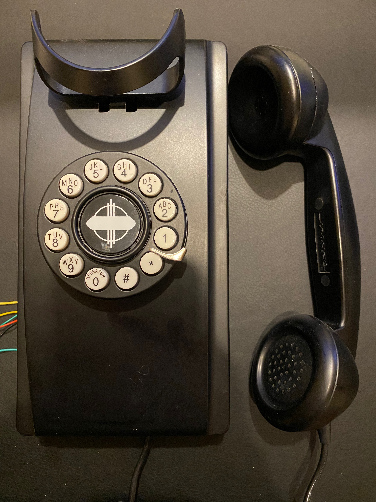
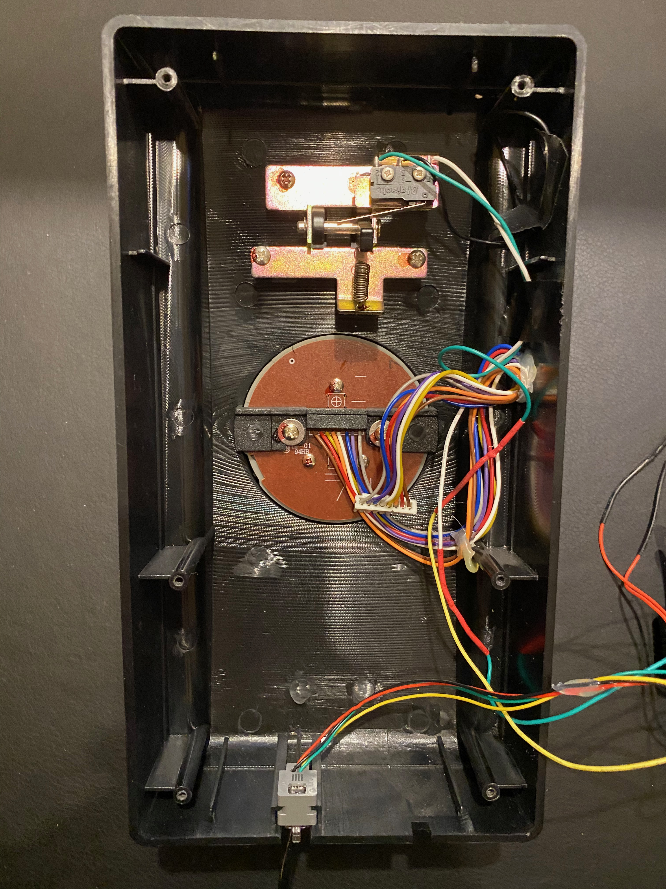
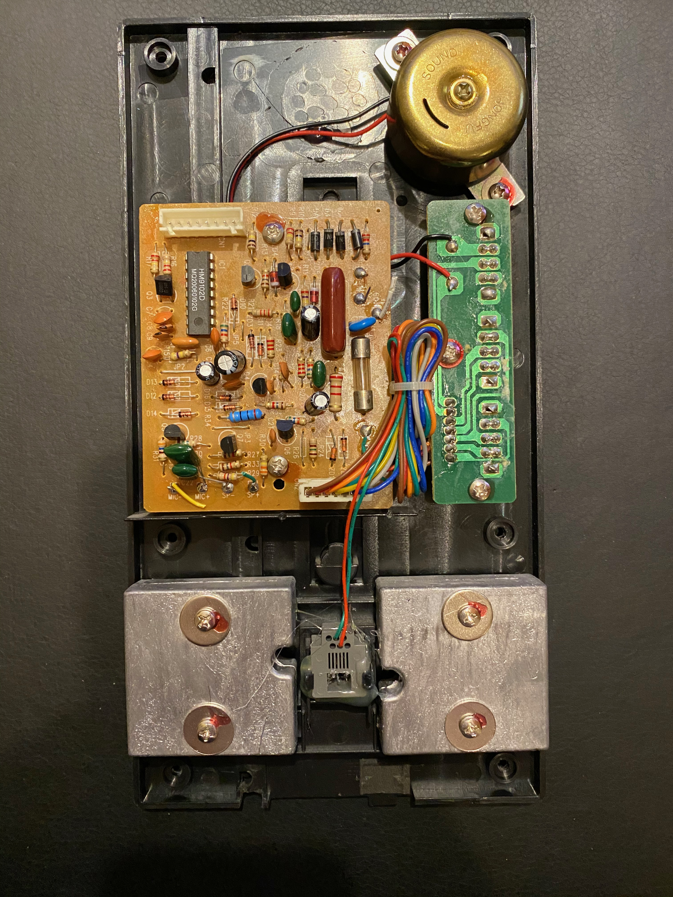
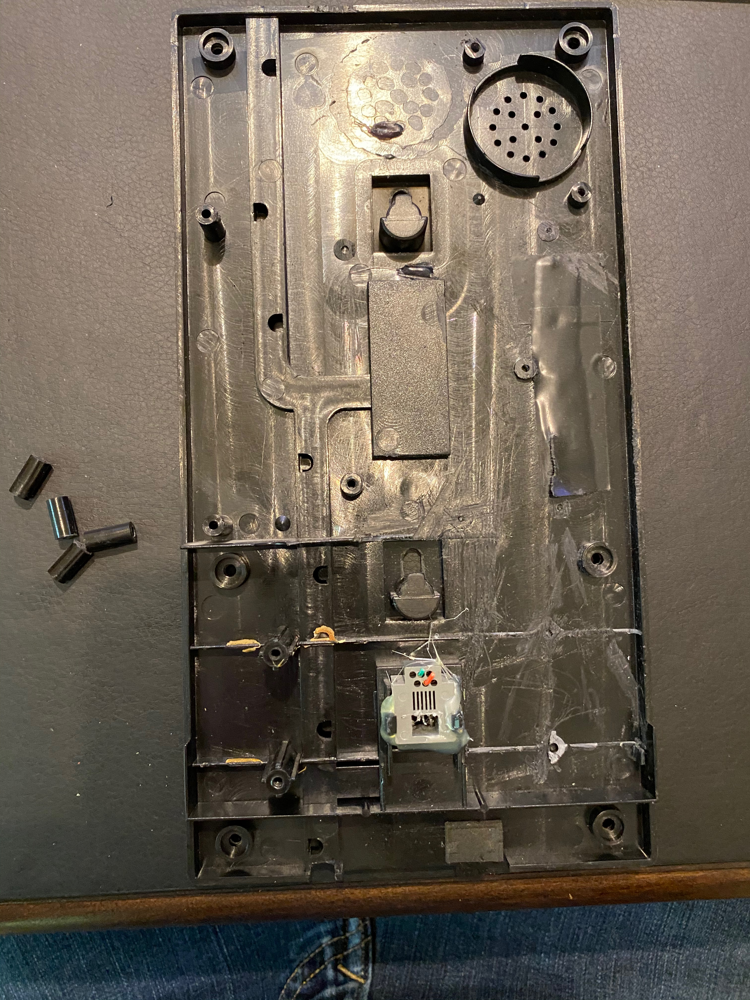

# SonosPhone
Hacked an old phone to control Sonos system with Alexa and keypad.



I've had an antique-looking phone for a while, it looks like an old rotary phone, but it has a touch-tone dial pad. Since I haven't had a standard (POTS) line for some time, I thought I'd turn it into a project.

Step one was to gut the phone and put in a Raspberry Pi Zero, add a power source, wire it up so the handset's microphone and speaker work with the Pi, and make the phone hook trigger an event on the Pi so we know when someone has lifted or set down the receiver.

I loaded the Pi with [AlexaPi](https://github.com/alexa-pi/AlexaPi) and made one feature change to the code. I didn't want to have the microphone always-on or use a "wake" word, so I modified AlexaPi to only listen when I take the phone off-hook. (Mar 2023 this has been removed)

## The Phone
The phone is a [Crossley CR55-BK](http://www.crosleyradio.com/telephones/product-details?productkey=CR55&model=CR55-BK). When taking it apart, the first thing you notice is that it is loaded with about 1.5 lbs of lead. This gives the phone a lot of heft and makes it feel like a classic, indestructible Bell telephone. I removed the lead from the phone body but kept it in the handset. I gutted everything else from the inside of the phone, including the ringer, and then cut out as many mounting pegs as I could. Removing the mouth and earpieces from the phone was troublesome. Lots of glue, but they did come off eventually. 



## Wiring the handset
It was unlikely that the existing microphone and speaker would work (and they didn't), so I replaced them. I kept the wiring intact, but removed the microphone and speaker, soldering in an 8 ohm, 2W [speaker](https://www.amazon.com/gp/product/B0177ABRQ6/ref=ppx_yo_dt_b_search_asin_title?ie=UTF8&psc=1) and added an [amplifier](https://www.amazon.com/gp/product/B00PY2YSI4/ref=ppx_yo_dt_b_search_asin_title?ie=UTF8&psc=1) to the Pi.

I had a difficult time finding a microphone that would work, so I tried an experiment with something really cheap in case it failed. I bought a super inexpensive USB [microphone](https://www.amazon.com/gp/product/B077ZBHPJG/ref=ppx_yo_dt_b_search_asin_title?ie=UTF8&psc=1) and basically took the whole thing apart and used its internal components. The USB mic was dismantled to remove the mic and then soldered to the two leads that come from the phone to the USB component. This basically puts a long wire on the mic. The mic was then placed in the handset and soldered.

## Wiring the hook
Internally, the phone hook is just a switch with two wires, so this was easy to wire to the Pi and use GPIO events to know if it was triggered or not. 
## Phase One Complete!!

So this gave me a cool, retro phone to control Sonos. 

# Phase Two - Pushbutton control

I am by no means a hardware engineer, so circuit design takes a lot of web searches in the hope that I can find someone who has done something similar. Figuring out how the rotary-style keypad worked seemed like a daunting task as I hadn't come across any other keypad like it. It has eight wires coming out of it. As it turns out, even though it is in a circular layout, the keypad works like many other keypads. The wires correspond to rows and columns. For any button press, two of the wires become "active". I brought out an ohmmeter and started testing. 8 wires, many combinations, but eventually found the pattern.

| Digit | Color 1 (row) | Color 2 (col)  |
| ----- |:-------------:|:--------------:|
| 1 | yellow | gray  |
| 2 | yellow | purple|
| 3 | yellow | white |
| 4 | orange | gray  |
| 5 | orange | purple|
| 6 | orange | white |
| 7 | red    | gray  |
| 8 | red    | purple|
| 9 | red    | white |
| * | brown  | gray  |
| 0 | brown  | purple|
| # | brown  | white |

Next, I wired each of these to an open GPIO port on the Pi and wrote some Python code to listen for these key presses. I used a [keypad library](https://github.com/rainierez/MatrixKeypad_Python) as the guts and wrote my button UI to interpret the keypresses. 

# Commands

I wanted the UI to be simple, so numbers 1-99 correspond to Sonos favorites and playlists. By editing each favorite/playlist name to have the pattern [XX] in their title, these can be referenced through the phone. (Ex: "Jazz Standards [1]" is triggered by just pressing the "1" key. No coding or configuration file to edit. Just edit the Favorite in the Sonos app itself. Favorites can be anything, a song, an album, a playlist, or even a link to a radio station in one of the Sonos services.

The other key commands I have wired up, including '**' for volume up, '*#' for volume down, and '*7' for shuffle.

The zero (0) key toggles play/pause.


## Sonos Controller

When a command is received, we then need to tell Sonos what to do. For that I used the very nice library from @jishi called [node-sonos-http-api](https://github.com/jishi/node-sonos-http-api). This library is a node web service that makes it super easy to control your Sonos. So, when the '1' key is pressed, I send a GET to this web service like `http://localhost:5005/Office/favorite/Fav1`. 


# Phase Three

Installed a camera inside the phone case and cut a thin slot in the side of the phone. Small, credit-card sized albums are now inserted into the slot where they are read by the camera. Once the album is recognized, the phone will play the album or playlist.

## Services Layout

Device-specific runners now live under services/ReadKey and services/ScanAlbum. The systemd units in those folders expect the code at /opt/services/ReadKey and /opt/services/ScanAlbum, keeping the relocated runners aligned with the deployed services.

# Phase Four - MCP Server for LLM Control

The SonosPhone now includes a Model Context Protocol (MCP) server that allows Large Language Models (LLMs) like Claude, ChatGPT, or other AI assistants to control your Sonos system through natural language.

## What is MCP?

The Model Context Protocol (MCP) is an open standard developed by Anthropic that allows AI applications to communicate with external systems in a standardized way. Think of it as a "USB-C for AI" - it provides a universal interface for LLMs to access and control various tools and services.

## MCP Server Features

The SonosPhone MCP server exposes the following tools to LLMs. **All tools accept a `room` parameter** to specify which Sonos room to control, making the server stateless and allowing control of multiple rooms without switching context.

### Room Management
- **get_room_status**: Get information about a specific Sonos room and its playback state
- **list_available_rooms**: Discover all Sonos devices on the network

### Playback Control
- **play_favorite**: Play a Sonos favorite by name in a specific room
- **play_uri**: Play media from a URI (Spotify, radio streams, etc.) in a specific room
- **play**: Start or resume playback in a specific room
- **pause**: Pause playback in a specific room
- **stop**: Stop playback in a specific room
- **next_track**: Skip to the next track in a specific room
- **previous_track**: Go back to the previous track in a specific room

### Volume Control
- **set_volume**: Set volume to a specific level (0-100) in a specific room
- **adjust_volume**: Increase or decrease volume by a relative amount in a specific room
- **toggle_mute**: Toggle mute on/off in a specific room

### Information
- **list_favorites**: List all available Sonos favorites from a specific room

## Running the MCP Server

### Prerequisites

Install the required dependencies:

```bash
pip install -r requirements.txt
```

Or using Poetry:

```bash
poetry install
```

### Starting the Server

#### Stdio Mode (for Claude Desktop and similar clients)

```bash
python scripts/run_mcp_server.py --transport stdio
```

#### HTTP Mode (for web-based clients)

```bash
python scripts/run_mcp_server.py --transport http --host 127.0.0.1 --port 8000
```

### Configuration Options

- `--transport`: Transport mode - "stdio" or "http" (default: "stdio")
- `--host`: Host to bind to for HTTP mode (default: "127.0.0.1")
- `--port`: Port to listen on for HTTP mode (default: 8000)

**Note**: The server no longer requires a default room parameter. Each tool accepts a `room` parameter to specify which Sonos room to control.

## Using with Claude Desktop

To use the MCP server with Claude Desktop, add the following to your Claude Desktop configuration file:

**macOS**: `~/Library/Application Support/Claude/claude_desktop_config.json`  
**Windows**: `%APPDATA%\Claude\claude_desktop_config.json`

```json
{
  "mcpServers": {
    "sonosphone": {
      "command": "python",
      "args": [
        "/path/to/SonosPhone/scripts/run_mcp_server.py",
        "--transport", "stdio"
      ]
    }
  }
}
```

After restarting Claude Desktop, you can ask Claude to control your Sonos. **You specify the room in your request**, not in the configuration:

- "Play my Jazz Standards favorite in the Living Room"
- "Increase the volume by 10 in the Kitchen"
- "What's currently playing in the Bedroom?"
- "Skip to the next track in the Office"

## Example Usage

Once connected to an MCP client (like Claude), you can use natural language commands:

```
You: "Play my Morning Jazz playlist in the Kitchen"
Claude: [Uses play_favorite tool with room="Kitchen"]
        "I've started playing Morning Jazz in the Kitchen."

You: "Turn the volume up a bit in the Living Room"
Claude: [Uses adjust_volume tool with room="Living Room"]
        "I've increased the volume by 10 in the Living Room."

You: "What rooms are available?"
Claude: [Uses list_available_rooms tool]
        "I found these Sonos rooms: Kitchen, Living Room, Bedroom, Office"

You: "Pause the music in the Kitchen and play something in the Bedroom"
Claude: [Uses pause tool with room="Kitchen", then play_favorite with room="Bedroom"]
        "I've paused the music in the Kitchen and started playing in the Bedroom."
```

## Security Considerations

- The MCP server requires access to your local network to discover and control Sonos devices
- In HTTP mode, the server binds to localhost by default for security
- Consider firewall rules and network access when deploying in production
- No authentication is currently implemented - ensure the server is only accessible to trusted clients

## Troubleshooting

### Sonos devices not found

- Ensure your Sonos devices are on the same network as the machine running the MCP server
- Check that UDP multicast is not blocked by your firewall
- Try restarting the Sonos devices

### MCP connection issues

- Verify the correct path is configured in your MCP client
- Check that Python and all dependencies are installed
- Review the server logs for error messages

## Development

The MCP server implementation is in `sonosphone/mcp_server.py`. Tests are in `tests/test_mcp_server.py`.

To run tests:

```bash
pytest tests/test_mcp_server.py -v
```
